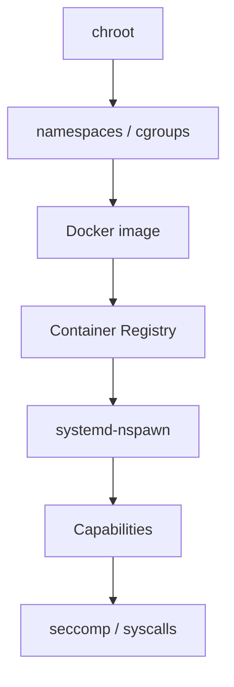

# Container 101

[](https://www.docker.com)
[](https://vagrantup.com)
[](LICENSE)
[](docs/01setup.md)

> A hands-on, ground-up introduction to Linux containers — no magic, just Linux.

Ever repaired a Linux system by booting a live CD and `chroot`-ing into it? Then you already understand the *soul* of containerization. This tutorial takes you from that mental model all the way to building, distributing, and securing OCI images.

---

## 🎯 What You'll Learn

By the end of this course you will understand, *hands-on*:

1. **The anatomy** of a Linux container (namespaces, cgroups, chroot)
2. **How to build** a minimal container image from scratch
3. **How to publish** and consume images from a public registry
4. **Alternative runtimes** beyond Docker (systemd-nspawn)
5. **Security primitives** (capabilities, seccomp, syscall tracing)
6. **How to debug** containers at the syscall level

Everything is exercised *in a real VM*, not just read about.

---

## 🚀 Quickstart

You need [Vagrant](https://www.vagrantup.com) and a provider (VirtualBox or UTM/QEMU for Apple Silicon).

```bash
git clone <this repo>
cd container101
vagrant up     # provisions Debian 13 ARM64 + docker + tools
vagrant ssh
```

Inside the box:
```bash
sudo su -              # most chapters assume root
cd /home/vagrant/container101
make                   # builds the sample helloworld binary
```

---

## 📚 Chapters

Each chapter is a self-contained lesson: explanation → verified exercise → deeper links.

| # | Chapter | Focus |
|---|---------|-------|
| 01 | [Setup](docs/01setup.md) | Prepare the environment |
| 02 | [Play with chroot](docs/02chroot.md) | The first isolation primitive |
| 03 | [Control Groups (cgroups)](docs/03cgroups.md) | Freeze, kill, monitor processes |
| 04 | [Namespaces](docs/04cgroups.md) | PID, mount, network isolation |
| 05 | [Docker Images](docs/05docker.md) | Build, run, and manage containers |
| 06 | [Container Registries](docs/06registry.md) | Push/pull from Docker Hub |
| 07 | [systemd-nspawn](docs/07nspawn.md) | The systemd-native runtime |
| 08 | [Capabilities & Permissions](docs/08security.md) | Fine-grained privilege control |
| 09 | [Syscalls & seccomp](docs/09syscalls.md) | Trace and restrict kernel interface |

---

## 🧭 Pedagogy

The chapters build upward in abstraction, but each is understandable on its own.



We start where containers *come from* (Plan 9 namespaces, chroot), because if you skip this you never truly understand Docker. Then we walk you up the stack to modern primitives.

---

## 📖 Further Reading

- Deep intro to container concepts: [A Brief History of Containers](https://blog.aquasec.com/a-brief-history-of-containers-from-1970s-chroot-to-docker-2016)
- Terminology: [A Practical Introduction to Container Terminology](https://developers.redhat.com/blog/2018/02/22/container-terminology-practical-introduction/)
- Hands-on with OCI runtimes: [Docker Labs](https://github.com/docker/labs)
- The bigger picture: [The Missing Introduction To Containerization](https://medium.com/devopslinks/the-missing-introduction-to-containerization-de1fbb73efc5)

---

## 💡 Tips

- All exercises are designed to be run **on a Linux host or VM** with Docker. We test on **Debian 13 (trixie) ARM64**.
- Some examples document different behavior between ARM64 and x86-64 — that's the point; container syscall layers differ per architecture.
- If a command fails in your version of Docker, check the chapter's note on *platform differences* — many behaviors changed between Docker 1.x and 26+.
- Want to discuss? Open an issue!

---

## 📝 License

MIT — see LICENSE.
