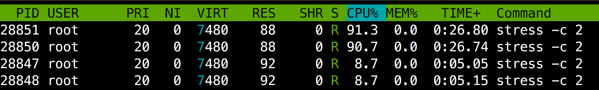

# 04 Play with cgroups (v2) & namespaces (Part 2)

In the previous exercise we manipulated cgroups by hand. With v1 that required the libcgroup tools (`cgcreate`/`cgset`/`cgexec`/`cgdelete`) because membership and settings lived in per-controller mounts. In **cgroup v2 there is just one filesystem tree and a uniform file interface**, so the "proper tool" is `echo`/`mkdir` — the kernel API *is* the filesystem. (libcgroup ≥ 2.0 also exists in a v2 flavour, but handwriting the files is more instructive.)

### How v2 resource control works

- All controllers hang off the single mount `/sys/fs/cgroup` (type `cgroup2`).
- A cgroup (directory) has **member processes** listed in `cgroup.procs` (write a pid → move the process, replacing v1's per-controller `tasks`).
- Controllers are not visible at a leaf by default. A parent must explicitly delegate them down the tree by writing `+cpu +memory +io +pids` into its **`cgroup.subtree_control`**. A cgroup's `cgroup.controllers` shows what is available *in* it.
- Two rules keep the tree sane:
  - **"No (internal) processes"**: a cgroup that has processes in `cgroup.procs` may not enable controllers in `cgroup.subtree_control` — controllers only work from a node *down* to children. (The root cgroup is exempt.)
  - **Top-down**: a child can only use a controller if all its ancestors enabled it.

Because systemd owns the root of the tree on a modern distro, and our shell already sits in `user.slice`, we must play by these rules.

### Exercise

Please start the following as root user, in the folder where you created the container from section 02.

First inspect where our own shell lives, and what the tree looks like. On a v2 system there is only the single `0::/` line:
```
# cat /proc/self/cgroup
0::/user.slice/user-1000.slice/session-1.scope

# cat /sys/fs/cgroup/cgroup.controllers
cpuset cpu io memory hugetlb pids rdma misc
```

Now create a `sandbox` cgroup and enable the controllers we want in it. We must enable them in every link of the chain root → sandbox, so first in the root, then (if applicable) in the parents, then we may move processes in:
```
# cd /sys/fs/cgroup

# echo "+cpu +memory +io +pids" > cgroup.subtree_control

# mkdir sandbox

# cat sandbox/cgroup.controllers
cpu io memory pids
```
`cpu io memory pids` are now available *inside* `sandbox`. (If you also wanted `cpuset`, you would additionally have to write the `cpuset.cpus`/`cpuset.mems` files.)

`cpu.max` is the v2 CPU bandwidth control `MAX PERIOD` in µs — MAX=10000 of PERIOD=100000 ≈ 10% of one CPU; MAX=100000 = 100% of one CPU; `max` = unbounded.

Move our process into `sandbox`, and start the namespaced shell inside the chroot. We chain: move the current (outer) shell into the cgroup, then `unshare` new namespaces and `chroot` in one go. Our VM is 2 vCPUs; set the cap to 100% of one CPU (`100000 100000`):
```
# echo 100000 > sandbox/cpu.max
# cat  sandbox/cpu.max
100000 100000

# echo $$ > /sys/fs/cgroup/sandbox/cgroup.procs

# unshare --mount --uts --ipc --pid --fork chroot container /bin/bash

bash-5.2# mkdir /proc                   # one-time, if you didn't make it in 02
bash-5.2# mount -t proc proc /proc
bash-5.2# cat /proc/self/cgroup
0::/sandbox
```
Inside our "container", we confirm that the `sandbox` group has been applied — and again, notice there is only **one** cgroup line, not eleven. The container sees a single unified hierarchy.

Next, confirm that our process is projected into its own mnt, uts and pid namespace. We mount `/proc` **manually** inside the chroot (the outer `--mount-proc` doesn't help here because `chroot` switches root first and the rootfs has no `/proc` yet). We even set a custom hostname:
```
bash-5.2# ps
    PID TTY          TIME CMD
      1 ?        00:00:00 bash
      7 ?        00:00:00 ps

bash-5.2# hostname
container101
bash-5.2# hostname hugabuga
bash-5.2# hostname
hugabuga
```
In another shell, check if we actually changed the hostname of our system? No — the uts namespace contained it.

### Stress: CPU limits in v2

In the next experiment, we stress the CPUs with `stress -c 2`. Watch the load with `htop` from another terminal.
```
bash-5.2# stress -c 2
```

**v1 vs v2 semantics change**: v1's `cpu.shares=100` was a *relative* share among peers, only kicking in under contention, and weighed against other threads' shares. v2 has two independent knobs:
- **`cpu.max`** (hard upper limit, bandwidth control) — we set it above; `stress` can never exceed it, even if the rest of the machine is idle.
- **`cpu.weight`** (relative share, 1–10000, default 100) — the v2 replacement of `cpu.shares` (`weight ≈ shares*100/1024`); only matters when siblings compete.

So on v2 you get predictable capping without having to generate competing load. While `stress` runs, watch from outside:
```
# cat /sys/fs/cgroup/sandbox/cpu.stat
usage_usec 5213459
user_usec 5200000
system_usec 13459
nr_periods 105
nr_throttled 96
throttled_usec 9587234
```
`nr_throttled` going up is the cgroup refusing cycles beyond `cpu.max`.



### The systemd-native way (recommended on real systems)

Writing into `/sys/fs/cgroup` directly fights with systemd, which considers itself the single ruler of the tree and may "tidy up" foreign cgrooups. On any systemd distro the intended way to get a transient, namespaced, resource-limited slice is `systemd-run` — one command instead of the whole mkdir/write ceremony:
```
# systemd-run --scope --quiet \
    --slice=limit \
    -p CPUQuota=10% -p MemoryMax=200M -p TasksMax=50 \
    --unit=sandbox \
    unshare --mount --uts --ipc --pid --fork --mount-proc chroot container
```
This (1) asks systemd to create a transient scope, (2) lets *it* do the `subtree_control` setup, (3) maps the high-level properties onto `cpu.max`/`memory.max`/`pids.max`, and (4) cleans the cgroup away when the process exits. Inspect it while it runs:
```
# systemctl status sandbox.scope
● sandbox.scope - [systemd-run] ...
   Transient: yes
     Active: active (running)
    Tasks: 1 (limit: 50)
    Memory: 164K (max: 200M, peak: 744K)
     CGroup: /limit.slice/sandbox.scope

# cat /sys/fs/cgroup/limit.slice/sandbox.scope/cpu.max     # 10% of one CPU
10000 100000
# cat /sys/fs/cgroup/limit.slice/sandbox.scope/memory.max  # 200M
209715200
# cat /sys/fs/cgroup/limit.slice/sandbox.scope/pids.max    # 50
50
```

>Because of the "no internal processes" rule, writing to `/sys/fs/cgroup` yourself under `user.slice` will *fail* (`EBUSY` on `subtree_control`) unless you first relocate your shell's peers. `systemd-run --scope` sidesteps this by creating a fresh child scope. That is why container runtimes (Docker, containerd, Kubernetes, runc) **always** go through the systemd API on cgroup v2 hosts.

When exiting our container, all changes were confined to namespaces associated with the `chroot` process — mounting `/proc`, the hostname — so after exit the namespaces are gone and the root environment is untainted.

The advanced reader could now immerse himself into the man page for [nsenter](https://man7.org/linux/man-pages/man1/nsenter.1.html) and, as an exercise, try to enter the namespace of our running container process.
