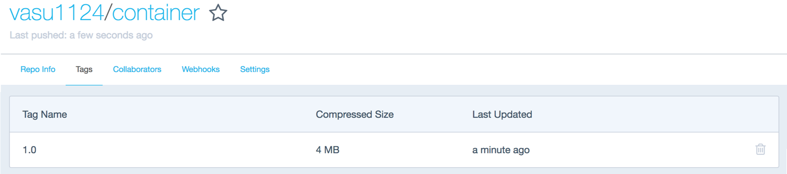

# 06 Swarm Intelligence with Container Registries

Obtain a free account at your favorite hosted Container Registry, [Docker Hub](https://hub.docker.com/), [Quay](https://quay.io/) or others. In the following examples, we will be using the most popular registry Docker Hub, which is the default with the docker cli & runtime. For an overview and comparison of public/hosted/private/on-premise registry options check [link 1](http://rancher.com/container-registries-might-missed/) and [link 2](http://blog.wercker.com/ultimate-guide-to-container-registries)

### Exercise

We will upload/push our container image into a public repository. First, we login to the registry; this is only required once, the docker cli saves your authorization credentials under `~/.docker/config.json`. Next, we tag the image with a url tag `docker.io/vasu1124/container:1.0` or for Docker Hub in short `vasu1124/container:1.0`; for other registries you have to use an absolute url. Lastly, if everything works, the image is pushed.
```
# docker tag container:1.0 vasu1124/container:1.0
# docker login
Login with your Docker ID to push and pull images from Docker Hub. If you don't have a Docker ID, head over to https://hub.docker.com to create one.
Username: vasu1124
Password: <password>
Login Succeeded

# docker push vasu1124/container:1.0
The push refers to a repository [docker.io/vasu1124/container]
5b73e1d6f17e: Pushed
1.0: digest: sha256:c668d2784a267f29ee6c397537c48454c3dba829da2f513b37a5fafd16975fac size: 527
```

If you now open the Browser to https://hub.docker.com/r/vasu1124/container/tags/, you will find our container image publicly accessible.


How about logging into a fresh system with docker installed and running `docker run -it vasu1124/container:1.0 /bin/bash`? If you do, you have just experienced the container benefits of standardized packaging & distribution. No need for complex installations & scripting.

The container image can now be used and/or extended by a community of users for which this image might be of interest. Beware that you are responsible for [ensuring copyrights, licenses and export controls](https://www.docker.com/docker-terms-service) are observed. All registry services offer multiple advanced, mostly paid features, ranging from integrating source to image CI/CD build pipelines to security & vulnerability scanners (see the Ubuntu [example](https://hub.docker.com/r/library/ubuntu/tags/latest/)).

It is now time to tap into the collective contributions of a decentralized, self-organized community and search for an image you can directly use (instead of building it from scratch). [Alpine Linux](https://alpinelinux.org/) is the de-facto standard for a minimal container base image: security-oriented, musl libc + busybox, and only **5 MB**:
```
# docker search --no-trunc alpine
NAME                DESCRIPTION                                                                                         STARS     OFFICIAL
alpine              A minimal Docker image based on Alpine Linux with a complete package index and only 5 MB in size!   11563     [OK]
alpine/git          A  simple git container running in alpine linux, especially for tiny linux distro.                  252
alpine/socat        Run socat command in alpine container                                                               120
alpine/curl                                                                                                             14
```
You can now choose from various options. Docker Hub offers some KPIs, such as how many "Stars" has the image obtained from the users, is it an "official" build from docker, or is an "automated" build process attached.

First, let us inspect the host system:
```
# cat /etc/os-release
PRETTY_NAME="Debian GNU/Linux 13 (trixie)"
NAME="Debian GNU/Linux"
VERSION_ID="13"
...

# uname -a
Linux container101 6.12.107+deb13-arm64 #1 SMP Debian 6.12.107-1 (2026-08-29) aarch64 GNU/Linux
```
So this is a Debian with an Debian kernel (and on ARM64).

Now, let us download, run and inspect the official `alpine:latest` image:
```
# docker run -it alpine:latest /bin/sh
Unable to find image 'alpine:latest' locally
latest: Pulling from library/alpine
a9986cd6f37d: Pull complete
Digest: sha256:294b683cb724975bec92580e1e685676bd4b50bda910ddb8c51d4cabeaec77e6
Status: Downloaded newer image for alpine:latest

/ # cat /etc/os-release
NAME="Alpine Linux"
ID=alpine
VERSION_ID=3.24.2
PRETTY_NAME="Alpine Linux v3.24"
...

/ # ls /bin | wc -l
82

/ # du -sh /
8.9M    /

/ # uname -a
Linux 9977cc543267 6.12.107+deb13-arm64 #1 SMP Debian 6.12.107-1 (2026-08-29) aarch64 Linux

/ # exit
```
Woa. Inside the container, it feels like a wholehearted Alpine. But the kernel is an Debian? ... Get used to it. This is the new world of containers, your musl-based image might run on a glibc-tuned host and vice versa, your support matrix just got hyperboled :-)

### Export

Where you can import, you can also export (need to keep the trade balance in check):
```
# mkdir alpine
# cd alpine; docker export <container-id> | tar xf -
```
Your local folder `~/alpine` now includes a complete Alpine v3.24 root filesystem. If you [figure out](https://github.com/linuxkit/linuxkit) where to get kernel & initrd from and how to appropriately boot into that system, you have an installer for an Operating System.

### Curated images from Docker
Checkout https://hub.docker.com/explore/ and more recently https://store.docker.com/ for curated and well maintained Docker images with many open source and commercial software products.

Lastly, there are two CNCF incubating projects dealing with managing cryptographic based trust and integrity of image & contents:
[The Update Framework (TUF)](https://github.com/theupdateframework/specification) and
[Notary](https://github.com/theupdateframework/notary).
